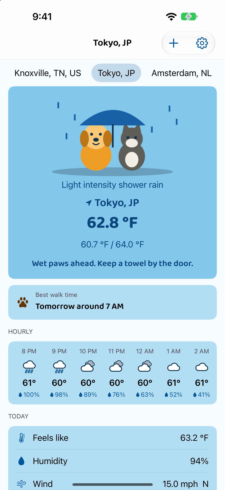
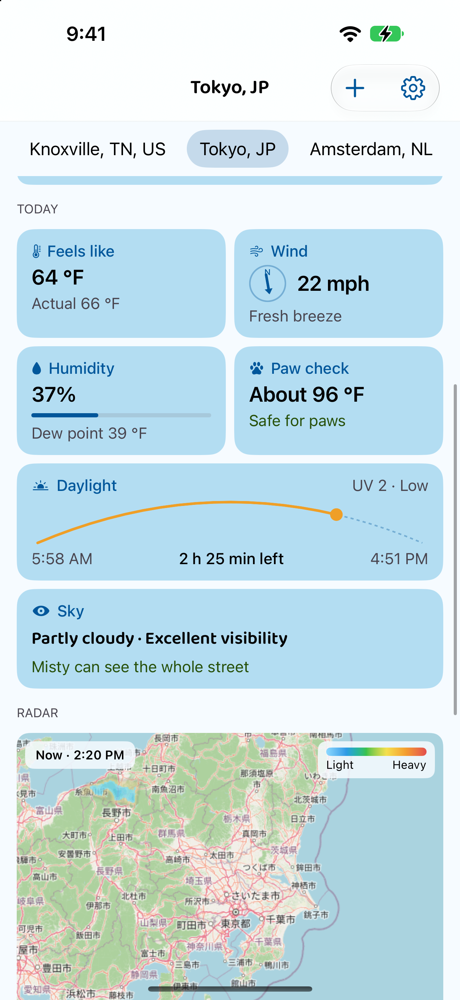
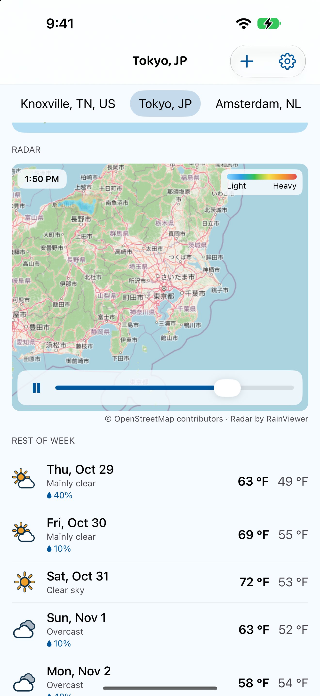
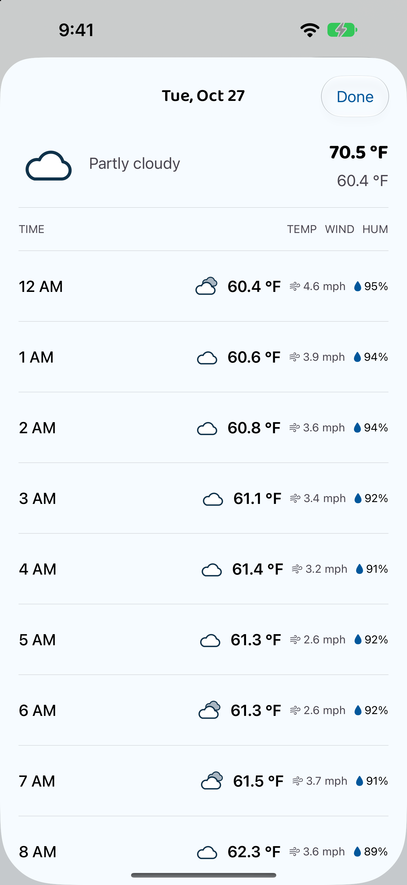
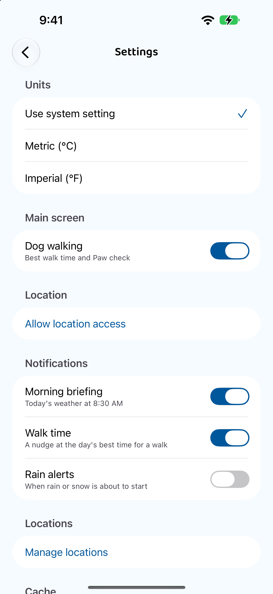
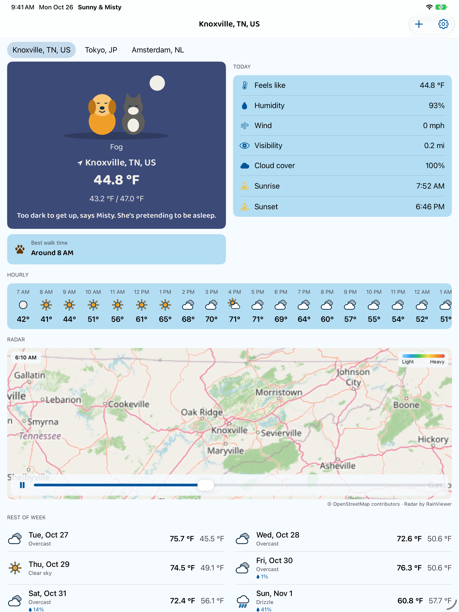

# Sunny & Misty (iOS)


A clean, modern iOS weather app, where Sunny the dog and Misty the cat act out the forecast. Track
current conditions, an hourly and 7-day forecast, and an animated precipitation radar for any
number of saved cities, see when to walk the dog, get a morning briefing, walk-time nudges and rain alerts, and switch
between metric and imperial units. Built with SwiftUI.

There is also a native Android version of the same product, built in Kotlin and Jetpack Compose:
[tuckercr/weather-android](https://github.com/tuckercr/weather-android). The two apps share one design, one
Firebase project and the same Remote Config keys, and new features ship on both.

## Screenshots

| Pets, walk time & hourly | Today tiles & air quality | Radar & rest of week | Day detail | Settings |
|---|---|---|---|---|
|  |  |  |  |  |

On iPad and in landscape, the pets sit beside today's details and the week splits into two columns.
Here Tokyo's air is "Unhealthy", so the walk card says "Bad air. Potty breaks only." and points
to a cleaner hour:



The App Store set is in [`screenshots/app-store/`](screenshots/app-store/); see [App Store](#app-store).

## How to run

1. Get a free API key from [OpenWeatherMap](https://openweathermap.org/api).
2. Copy the secrets template:

   ```bash
   cp "Cats&Dogs/Secrets.example.plist" "Cats&Dogs/Secrets.plist"
   ```

3. Edit `Cats&Dogs/Secrets.plist` and replace `your_key_here` with your key.
4. Open `Cats&Dogs.xcodeproj` in Xcode and run on a simulator or device.

New API keys can take up to two hours to activate.

`Secrets.plist` is gitignored so your key is never committed.

Firebase is optional. Without `GoogleService-Info.plist` the app builds and runs normally, with
analytics off and Remote Config on its built-in defaults. See [Firebase](#firebase).

Requires **iOS 17+**.

The app is called **Sunny & Misty** ("Sunny & Misty: Pet Weather" on the App Store). The Xcode project, target
and scheme keep the original Cats&Dogs name on purpose. The bundle ID is `com.fangjet.weather`.

## App flow

1. **Splash**: Sunny and Misty with the "Sunny & Misty: Pet Weather" wordmark.
2. **Welcome**: first launch only; tap **Get started**.
3. **Notification onboarding**: opt in to the 8:30 AM briefing (and, with a dog, walk-time nudges), or **Not now**.
4. **Location onboarding**: use the device location, or **Enter a city manually**.
5. **Current weather**: the main screen for the active city:
   - Hero card: Sunny and Misty act out one of 8 weather moods (sunny, cloudy, rain, storm, snow, hot,
     cold, night) on a mood-coloured card, with the city, temperature, today's high and low (from
     the forecast, over the whole day and taking in the temperature now) and a caption in the
     pets' voice ("Sunny wants puddles. Misty wants a towel."). One caption is picked per day; at
     night it follows the city's time of night (evening, late night, before dawn). The moon shows
     its real phase, lit from the other side in the southern hemisphere. Tap the card for today's
     hourly detail. The art is drawn in code as a placeholder, isolated in `PetScene`.
   - **Best walk time**: "Now is a great time", the next good hour ("Around 8 AM", or "Tomorrow
     around 7 AM" when it falls on the city's next day), or "Not a good day for walkies" when nothing
     in the next 24 hours qualifies. A good hour is under 30% rain chance, at a comfortable
     feels-like temperature, between 7 AM and 8 PM, in daylight and with pavement under 45 °C
     (113 °F), and when it is raining now, now never counts, whatever the hourly forecast says. The
     paw is tinted by the rating, and a caption explains hot pavement (estimated 52 °C / 125 °F,
     even on a mild day, and named only when it is the reason) or freezing weather.
     Hours with unhealthy air (US AQI above 150, or Europe's "Poor" and worse; the band is
     `walk_bad_air_band` in Remote Config) are never suggested, and when the air is bad now the card
     says "Bad air. Potty breaks only." Heat still outranks it.
     It can be turned off in Settings.
   - **Next rain**: one line under the top card, only when rain or snow is due in the next 2 hours:
     "Rain starting around 3:15 PM", "Rain stopping around 4:30 PM" or "Rain for the next 2 hours",
     from Open-Meteo's 15-minute forecast (0.1 mm in 15 minutes counts; it stops after 30 dry
     minutes). Rules in `Utilities/NextRain.swift`.
   - **Hourly**: the next 24 hours, with rain chance. Cities without coordinates fall back to
     OpenWeatherMap, which is 3-hourly, so the strip spans three days for them.
   - **Weather icons** are bundled with the app (vector assets drawn in the pets' style, with the
     pets' navy outline so they read on light and dark cards). Night icons show the moon's phase for
     that hour.
   - **Today**: feels like, humidity, wind ("0 mph", with no direction, when calm), visibility,
     cloud cover, UV index (daytime only), sunrise and sunset. Visibility is in miles or km to
     match the units (for "Use system setting", the device's measurement system: miles in the US
     and UK), and reads "Clear" at OpenWeather's 10 km cap.
   - **Air quality**: the hour in progress from Open-Meteo's air quality forecast, on Europe's index
     for cities on a European clock and the US AQI everywhere else: the number, its band ("Good" to
     "Hazardous", with "Poor for some" for the US "Unhealthy for sensitive groups"), a six-colour bar
     and a line about walks with a dog ("Fine for most walks") or about people without one. VoiceOver
     also reads the main pollutant ("Mostly ozone"). It comes with the forecast, in the same request
     the walk planner uses, so it's cached and shows offline. `air_quality_enabled` in Remote Config
     turns it off.
   - The small tiles sit in pairs; when there's an odd one out (Air quality, with Paw check showing)
     it takes the full width.
   - **Radar**: RainViewer's recent radar frames animated over an OpenStreetMap base map, with the
     frame time, a Light→Heavy legend, play/pause and a scrubber. A caption under the map credits
     OpenStreetMap and RainViewer. Frames are refetched once they are 10 minutes old (checked every
     minute while the radar is on screen, and on returning to the app), with the old frames kept up
     until the new ones arrive.
   - **Rest of week**: one row per day (sample closest to local noon) with rain chance (the day's
     highest hour; hidden under 10%, otherwise to the nearest 10%, as everywhere in the app); tap a
     row for each hour's temperature and rain chance.
   - All times (hours, days, sunrise and sunset, radar frames and "today") are in the city's own
     time zone, not the device's.
   - On landscape phones and iPad the pets and walk card sit beside today's details, and the week
     splits into two columns.
   - City tabs appear under the title once two or more cities are saved.
   - Pull to refresh. Data also refreshes silently whenever the app returns to the foreground
     (unless `foreground_refresh_min_minutes` says that city was fetched recently), every 30 minutes
     while the app stays open, and periodically in the background. Each refresh also moves the
     clock on, so hours that have passed drop off and a screen left open overnight keeps up.
   - The walk card, the radar and air quality can each be switched off from Remote Config.
6. **Add city** (＋): search with geocoding suggestions; choosing a suggestion pins exact coordinates.
   **Add city** without choosing one takes the top suggestion. A name with no suggestions at all is
   added as typed and geocoded again at launch, on returning to the app, and when another city is added.
7. **Settings** (gear), top to bottom:
   - **Units**: system, metric, or imperial.
   - **My Pets**: *I have a dog* turns on the walk card, the Paw check tile, the briefing's walk
     sentence and the Walk time notification ("Walk times, pavement checks and walk reminders").
   - **Notifications**: a row showing how many are on ("2 on", or "Off"), which opens its own screen:
     - Asks for permission if it hasn't been given (in-app while never asked, since iOS has no
       Settings entry yet; a denied one links to this app's notification settings in iOS Settings).
     - Then a switch for each kind: *Morning briefing*, *Walk time* and *Rain alerts*. Walk time only
       shows with a dog, and a kind switched off in Remote Config is hidden. A hidden switch keeps
       its value for when it comes back.
     - Debug builds add *Send sample notifications* (see [Trying notifications](#trying-notifications)).
     - iOS Settings › Notifications › Sunny & Misty links straight to this screen.
   - **Location**: permission status. Never asked: asked in-app; denied: links to the iOS Settings
     app. Granting it here adds your current location as a city.
   - **Locations**: *Manage locations* to add, reorder and delete cities (swipe, or Edit). A bell
     marks the city notifications are for: My Location, otherwise the top city. The city tabs on the
     main screen choose which city it shows.
   - **Cache**: clear cached weather.
   - **Privacy**: *Share usage statistics* turns analytics on or off. It starts on, except in the EU,
     EEA, UK and Switzerland, where it starts off until the user turns it on.
   - **About**: OpenWeather and Open-Meteo attribution, the
     [privacy policy](https://sunnyandmisty.com/privacy), and the version at the bottom ("Version 1.0",
     with "· Debug build" in debug builds).
8. **Update prompts**, from Remote Config: below `ios_min_supported_version` the app shows only
   "Time for an update" with an Update button; below `ios_min_recommended_version` a banner offers
   the update, and *Not now* hides it for a week. Debug builds can show either with the launch
   argument `-updatePrompt required` or `-updatePrompt recommended`.

### Where the data comes from

| Data | Source |
|---|---|
| Current conditions, city search | OpenWeatherMap (needs the API key) |
| Forecast for cities with coordinates | [Open-Meteo](https://open-meteo.com): true hourly data, UV index, and solar radiation for the pavement estimate. Free, no key. |
| Forecast for name-only cities | OpenWeatherMap's 3-hourly `/forecast`, as a fallback |
| Air quality | [Open-Meteo's air quality API](https://open-meteo.com/en/docs/air-quality-api): hourly US and European indices per pollutant, fetched alongside the Open-Meteo forecast. Free, no key. |
| Radar | [RainViewer](https://www.rainviewer.com/api.html) frames (free, no key) at zoom 7, the highest it serves |
| Base map | OpenStreetMap tiles |

Open-Meteo's weather codes are mapped onto OpenWeatherMap-style conditions and icon codes, so the
icons and pet moods work the same for both sources.

### Caching and errors

The last successful current weather and forecast are cached per city in `UserDefaults`. Cached data
is shown immediately while a refresh runs, and is kept on screen if the refresh fails. Errors only
surface when there is nothing cached, with **Retry** where retrying can help (offline, rate limited,
server error) and without it where it cannot (bad API key, city not found).

### Background refresh and notifications

If allowed, the app queues local notifications for one city, My Location when it's saved and
otherwise the first in the list (not whichever tab was last viewed), each kind with its own switch
in Settings:

- **Morning briefing** at 8:30 AM (on): "52° and partly cloudy in Knoxville / High 70°, low 45°, 60%
  chance of rain. Sunny's picked 1 PM for a walk." (the walk sentence only with a dog at home).
- **Walk time** (only with a dog): at the first good walk hour today and tomorrow. When that hour has
  already started at 8:30 the briefing says "now's a great time" instead, unless the briefing is off.
- **Rain alerts** (off): up to an hour before rain or snow starts, from the 15-minute forecast,
  between 7 AM and 9 PM city time, once per shower.

Android works these out at the time (`WeatherNotificationWorker` at 8:30, a one-off `WalkTimeWorker`,
and the periodic refresh for rain). iOS cannot run code at a fixed time of day, so
`NotificationPlanner` works them all out ahead from the cached forecast, and
`WeatherBackgroundRefresher` refreshes that cache in a `BGAppRefreshTask`. Each time iOS grants
background time it:

1. fetches current weather and the forecast for that notification city,
2. writes them to the per-city cache, so the app opens with fresh data,
3. replans the queued notifications from it, and
4. requests the next run after `weather_refresh_interval_minutes` (default 30, as on Android), or 15
   minutes after a failed fetch.

The notifications themselves are on calendar triggers, so they always arrive on time. A week of
briefings is queued, none repeating; each carries that day's forecast, and those beyond it say
"Tap to see today's weather." Each background run, each Settings change and each time the app
itself loads new data replaces the whole queue.

> **iOS decides when background refresh runs.** The interval is a minimum, not a schedule: iOS
> learns from how often the app is opened, and runs nothing if the user force-quits the app or turns
> off *Background App Refresh*. Expect fresher notifications for regular users than for occasional ones.

Background tasks never fire on the simulator. To trigger one on a device, run from Xcode, send the
app to the background, pause in the debugger and enter:

```
e -l objc -- (void)[[BGTaskScheduler sharedScheduler] _simulateLaunchForTaskWithIdentifier:@"com.fangjet.weather.refresh"]
```

The task identifier and the `fetch` background mode are declared in [`Cats&Dogs/Info.plist`](Cats&Dogs/Info.plist),
which Xcode merges with the generated Info.plist.

### Trying notifications

Debug builds only, to see each kind without waiting for 8:30 or the weather. Release builds include
none of this.

**What's sent:** five notifications, 5 to 17 seconds later: two briefings (so a group forms), a walk
nudge, rain and snow. The weather is made up, but the city is the real notification city (My
Location, otherwise the top city), and the text follows *I have a dog* the way the real ones do.

**How to send them** (notifications must be allowed first):

- In the app: Settings › Notifications › *Send sample notifications* (bottom of the screen).
- From the terminal, on a simulator:

  ```bash
  xcrun simctl launch --terminate-running-process CatsDogs-Tests com.fangjet.weather -sendSampleNotifications
  ```

  `--terminate-running-process` matters: if the app is already running, `simctl launch` just brings
  it forward and the argument is ignored.

**Where to see them:**

- With the app open: debug builds show them as banners.
- The Lock Screen lists everything delivered, stacked by kind (briefings, walk, rain). Lock and wake
  the simulator (Device › Lock, then the Home button) if Notification Center can't be pulled down.

**The real ones:** they're planned from the cached forecast (see above), so the quickest way to
replan is to open the app, or change a switch under Settings › Notifications. A simulator needs a
location for My Location:

```bash
xcrun simctl location CatsDogs-Tests set 36.21,-83.29
```

## Architecture

| Layer | Choice |
|---|---|
| UI | SwiftUI, `NavigationStack` |
| State | `@Observable` view models on the main actor |
| Networking | `URLSession` + `Codable` behind `OpenWeatherAPI`, `OpenMeteoAPI` and `GeocodingAPI` protocols, plus an injectable RainViewer fetch (all faked in tests) |
| Persistence | `UserDefaults` via `PreferencesStore`: onboarding flags, saved cities, unit override, walk card and usage-statistics settings, weather cache |
| Location | Core Location (when-in-use) |
| Notifications | `UserNotifications` local calendar triggers |
| Background work | `BackgroundTasks` (`BGAppRefreshTask`) via SwiftUI `.backgroundTask` |
| APIs | OpenWeatherMap `/weather`, `/forecast` and Geocoding (free tier); Open-Meteo; RainViewer; OpenStreetMap tiles |
| Fonts | Baloo 2 for display and title text (SIL OFL, licence bundled) |
| Analytics and config | Firebase Analytics (`FirebaseAnalyticsCore`) and Remote Config via Swift Package Manager, both optional |
| Dependencies | Firebase iOS SDK 12.x; everything else is Apple frameworks |

```
Cats&Dogs/
  Config/      API key loading
  Data/        Repositories, PreferencesStore, Remote Config
  Domain/      Units and unit override
  Models/      Weather and radar models, SavedLocation, CitySuggestion, LoadingState
  Services/    API clients, DTOs, forecast aggregation, notifications, background refresh, analytics,
               Firebase setup
  Resources/   Fonts
  Utilities/   Formatting, error messages, brand fonts and colours
  ViewModels/
  Views/       Screens; Pets/ holds the pet scene, moods, walk advice and their thresholds
```

## Accessibility

- VoiceOver labels on every control, including the radar slider (read as the frame's time) and
  the hourly weather icons. The selected unit and the active city tab carry the Selected trait.
- Touch targets of at least 44 pt (radar play button, city tabs).
- Text meets WCAG AA contrast: the light theme's blue is `#01579B` and secondary text uses
  `SecondaryText` rather than the system grey. The brand colour is applied as the app's tint
  explicitly, since iOS 27 doesn't apply the asset catalog's global accent colour.
- Layouts scale with Dynamic Type, up to the accessibility sizes.

## Platform differences

The iOS and Android apps have the same features. Where the platforms differ:

| | iOS | Android |
|---|---|---|
| Briefing, walk time, rain alerts | Planned ahead from the latest cached forecast | Worked out at the time (walk time re-checked when due) |
| Background weather refresh | `BGAppRefreshTask`, no sooner than the Remote Config interval | WorkManager, every 30 minutes (Remote Config) |
| "Use system setting" for temperature | By region | Android 14+ temperature preference, else region |
| Crash reporting | Xcode Organizer crash reports | Crashlytics, release builds only |
| *Share usage statistics* | Settings › Privacy | Settings › About |
| UI tests in CI | None yet | Compose UI tests |
| Release code shrinking | Not needed (Swift compiles to native code) | R8 minification and resource shrinking |

## Tests

Unit tests live in the `Cats&DogsTests` target (XCTest): 238 tests in 24 classes. Run them in Xcode
with **⌘U**, or from the Test navigator.

Shared with Android (the same cases on both platforms):

- `ForecastAggregatorTests`: noon slot selection, multi-day grouping, rain chance, local hour, UV
- `OpenWeatherParsingTests`: JSON decoding for API responses, including UTC offsets and rain chance
- `WeatherUnitsTests`: imperial vs metric by region, Celsius conversion
- `WeatherRepositoryTests`: repository mapping and error handling (fake API), Open-Meteo switched off by Remote Config
- `GeocodingRepositoryTests`: suggestion formatting and validation (fake API)
- `NotificationWorkerLogicTests`: background fetch, permission and retry behaviour
- `NotificationPlannerTests`: briefing times and text, walk-time nudges, rain alerts (lead, quiet hours, once per shower), the switches
- `OpenMeteoForecastTests`: hour filtering, city time zones (including half-hour zones and DST), WMO codes, UV, pavement heat
- `RadarTests`: RainViewer timeline parsing, tile URLs, load-once and retry, refreshing a stale timeline while the old one stays on screen
- `PetMoodTests`, `WalkAdvisorTests` (both in `PetTests.swift`): mood mapping, night captions by the city's local hour, walk ratings including walking hours, daylight, raining now and pavement heat, Remote Config thresholds, today vs tomorrow in the city's time zone, the 24-hour cap, dropping past hours
- `MoonPhaseTests`: the phase from the date, checked against published phases
- `WeatherIconViewTests`: icon for each condition by day and night, moon phases, southern-hemisphere mirroring, every asset present
- `CityListViewModelTests`: loading and legacy migration, add (with geocoding and de-duplication), remove, set active, reorder
- `WeatherForecastViewModelTests`: request routing, cache-first display, error mapping, silent background refresh, the foreground-refresh window, analytics events, and races between overlapping requests
- `GeoLocationViewModelTests`: debounced search, latest-input-wins, suggestion pinning, reset
- `LocationPermissionViewModelTests`: denied, located and failed states
- `SettingsViewModelTests`: unit override persistence, clear cache, permission requests, usage-sharing opt-out, the walk card setting
- `WelcomeViewModelTests`: onboarding flags, including installs that predate the notification step, and the onboarding-complete event
- `AnalyticsRepositoryTests`: the three analytics gates and pushing the opt-out into the SDK
- `PetWeatherThresholdsTests`: walk and pet threshold ranges and pair checks

iOS only:

- `WeatherBackgroundRefresherTests`: background refresh caching, notification rescheduling and retry timing
- `PreferencesStoreTests`: per-city cache round trip, eviction when a city is removed, older cache format
- `WeatherFormattingTests`: sunrise and sunset in the city's time zone, UV categories, calm wind, visibility in miles or km and "Clear"
- `RemoteConfigRepositoryTests`: defaults, the refresh-interval floor, radar-speed and foreground-refresh limits

View-model tests run against real repositories with scripted API fakes, and a `PreferencesStore` backed
by a throwaway `UserDefaults` suite, so they never touch the app's real data. Shared helpers (including
`Gate`, which holds fake requests open so tests can control the order responses arrive in) live in
`ViewModelTestSupport.swift`.

## CI

GitHub Actions runs on every push and pull request to `main` (see [`.github/workflows/ios.yml`](.github/workflows/ios.yml)).

The workflow builds the app with Xcode 16.4, runs the unit tests on an iOS 18 simulator, and uploads
the `.xcresult` bundle as an artifact for inspecting failures.

The app targets **iOS 17+** so unit tests can run on the simulator runtimes preinstalled on GitHub-hosted Mac runners.

Xcode 16.4's Swift 6.1 compiler crashes on closure default arguments that are main-actor isolated
or read main-actor state. Initializers therefore take optional closures (`fetch: (() -> T)? = nil`)
and fill in the default in the body; keep to that pattern so CI keeps building.

Add the same OpenWeather API key used for Android as a repository secret:

1. GitHub repo → **Settings** → **Secrets and variables** → **Actions**
2. Create secret **`OWM_API_KEY`** with your key

At build time the workflow writes that value into `Secrets.plist` (the file stays gitignored locally).

Optionally add **`GOOGLE_SERVICE_INFO_PLIST`**, the base64 of `GoogleService-Info.plist`
(`base64 -i "Cats&Dogs/GoogleService-Info.plist" | pbcopy`), to build CI with Firebase included.
Without it CI builds with Firebase switched off. Unit tests never start Firebase either way.

## Firebase

Both apps share the Firebase project **`cats-dogs-weather`**, with Google Analytics
linked. The iOS app is registered as `com.fangjet.weather`.

To build with Firebase, download `GoogleService-Info.plist` for the iOS app (Firebase console →
Project settings → Your apps, or `firebase apps:sdkconfig IOS <app id> --project cats-dogs-weather`)
and put it in `Cats&Dogs/`. It is git-ignored; the synchronized folder picks it up with no project
change. Without it, Firebase is never started.

Remote Config parameters are defined and deployed from the Android repo
(`firebase/remoteconfig.template.json`), so both platforms read the same values:

| Key | Default | Used for |
|---|---|---|
| `weather_refresh_interval_minutes` | 30 (minimum 15) | Earliest next background refresh |
| `radar_frame_interval_ms` | 850 (100–5000, otherwise the default) | Radar animation speed |
| `analytics_enabled` | true | Kill switch for every analytics event, and SDK collection |
| `radar_enabled` | true | Hides the radar card if RainViewer or the OpenStreetMap tiles become unavailable |
| `walk_card_enabled` | true | Hides the "Best walk time" card for everyone; users can also turn it off in Settings |
| `daily_weather_notifications_enabled` | true | The morning briefing; off removes the queued ones and hides its switch in Settings |
| `walk_time_notifications_enabled` | true | The Walk time nudge; off removes the queued ones and hides its switch in Settings |
| `rain_notifications_enabled` | true | Rain alerts; off removes the queued one and hides its switch in Settings |
| `foreground_refresh_min_minutes` | 0 (0–1440) | Skips the silent refresh on returning to the app if that city was fetched this recently. Pull-to-refresh and city changes are never skipped |
| `walk_hot_pavement_c` | 52 (40–70) | Pavement temperature that triggers the hot-paws warning |
| `walk_warm_pavement_c` | 45 (30–65, below `walk_hot_pavement_c`, otherwise 7 below it) | Pavement temperature at which the Today Paw check tile says "Getting hot" and that hour isn't suggested for a walk (a walk now rates "okay") |
| `walk_dangerous_pavement_c` | 57.2, which is 135 °F (45–80, above `walk_hot_pavement_c`, otherwise 5 above it) | Pavement temperature at which the Today Paw check tile says "Dangerously hot" |
| `walk_icy_pavement_c` | 0 (−20–10) | Pavement temperature below which the Today Paw check tile says "Icy, watch for salt" after rain or snow in the last 12 hours or with snow on the ground, and "Below freezing" otherwise |
| `walk_max_rain_chance` | 30 (0–100) | Rain chance at or above which an hour isn't suggested for a walk |
| `walk_comfort_min_c` / `walk_comfort_max_c` | 3 (−20–20) / 27 (15–40) | Comfortable walking temperatures (feels-like) |
| `walk_hours_start` / `walk_hours_end` | 7 / 20 (0–23) | Local hours walks are suggested in, inclusive |
| `pet_hot_threshold_c` / `pet_cold_threshold_c` | 30 (20–45) / 0 (−20–10) | Feels-like temperatures that switch the pets to their hot and cold moods, and the walk card to "paws hot" and "too cold" |
| `walk_bad_air_band` | 3 (1–5) | Air quality band (0 good to 5 worst) from which hours aren't suggested for a walk and the walk card says "Bad air". 3 is US "Unhealthy" and Europe's "Poor" |
| `open_meteo_enabled` | true | Off sends forecasts for cities with coordinates to OpenWeatherMap (3-hourly) instead of Open-Meteo |
| `air_quality_enabled` | true | Off stops fetching air quality: no Air quality tile, and the walk planner ignores the air |
| `openweather_api_key` | "" | Replacement OpenWeather API key, used from the next launch; empty uses the key built into the app. Lets a leaked key be rotated without an update. Not secret: Remote Config values reach every device |
| `ios_min_supported_version` | "" | Below this version (e.g. `1.1`) the app shows only "Time for an update" until it's updated. Empty never asks. Android has its own key |
| `ios_min_recommended_version` | "" | Below this version a banner above the weather suggests updating; "Not now" hides it for a week. Empty never asks |
| `ios_app_store_url` | "" | The App Store link behind the Update buttons; empty hides them until the App Store record exists |

Walk and pet temperatures are Celsius whatever units the user picked. An out-of-range value falls
back to its default, and if a pair ends up inverted (minimum not below maximum), both fall back to
their defaults.

A missing or unreadable value always falls back to the default, so a console mistake can't break the
app. New values are fetched at most hourly; most apply on the next read, the analytics SDK switch on
the next launch.

### Analytics

The events and parameters match Android, so both platforms report into the same dashboards:

| Event | Parameters | When |
|---|---|---|
| `onboarding_complete` | None | The last onboarding step (location) finished or was skipped |
| `city_added` | None | A new city was saved (re-adding an existing one doesn't count) |
| `settings_opened` | None | Settings opened from the gear |
| `weather_error` | `error_key` (e.g. `offline`, `city_not_found`) | A current-weather or forecast fetch failed, even if cached data hid the error |

An event is sent only when all three gates are open:

1. Firebase is configured.
2. The Remote Config kill switch `analytics_enabled` is on.
3. **Settings → Privacy → Share usage statistics** is on. It starts on, except in the EU, EEA, UK
   and Switzerland (by the device's region), where analytics need opt-in consent, so it starts off
   until the user turns it on. Changing it isn't tracked, and clearing the cache keeps the choice.

`FIREBASE_ANALYTICS_COLLECTION_ENABLED` is false in `Info.plist`, so Firebase collects nothing until
the app has applied that choice at launch.

Gates 2 and 3 are also enforced in the SDK with `setAnalyticsCollectionEnabled`, so Firebase's
automatic events (sessions, screen views) stop too.

The app links `FirebaseAnalyticsCore`, so no advertising identifier or ads SDK is included, and
`GOOGLE_ANALYTICS_DEFAULT_ALLOW_AD_PERSONALIZATION_SIGNALS` is off. Firebase ships its own privacy
manifests; see [App Store](#app-store) for the app's own.

Firebase 13 needs Xcode 26.1 (Swift 6.2.1). The project stays on 12.x until CI moves off Xcode 16.4.

## App Store

- [`docs/app-store/listing.md`](docs/app-store/listing.md) is the draft App Store Connect listing:
  name, subtitle, description, keywords and the rest.
- [`screenshots/app-store/`](screenshots/app-store/) holds the 6.9-inch iPhone screenshots
  (1320 × 2868) and the 13-inch iPad ones (2064 × 2752). App Store Connect requires iPad
  screenshots because the app runs on iPad. Taken on 10-30 with the status bar at 9:41:

  | File | Shows |
  |---|---|
  | `01-welcome.png` | Onboarding: meet Sunny and Misty |
  | `02-today.png` | San Francisco (My Location): the pets, "Now is a great time" and the hourly strip |
  | `03-rain-walk.png` | Bogotá in the rain: the umbrella scene, "Rain stopping around 7:00 PM" and "Tomorrow around 7 AM" |
  | `04-radar-week.png` | The animated radar and the rest of the week |
  | `05-day-detail.png` | A day's hour-by-hour detail |
  | `06-settings.png` | Settings: units, I have a dog, notifications |
  | `ipad-01-amsterdam.png` | Amsterdam at night, with air quality on Europe's scale |
  | `ipad-02-tokyo.png` | Tokyo with unhealthy air: "Bad air. Potty breaks only." |

  Suggested upload order: 02, 03, 04, 05, 06 (01 optional); iPad 02 then 01.
- Release builds fail if `Cats&Dogs/Secrets.plist` is missing or has no OpenWeather key (the "Check
  OpenWeather API key" build phase), so an archive can't ship without one. Debug builds skip the
  check. Radar map tiles are requested with a `SunnyAndMisty/<version>` User-Agent and cached on
  disk, as OpenStreetMap's tile policy asks.
- [`Cats&Dogs/PrivacyInfo.xcprivacy`](Cats&Dogs/PrivacyInfo.xcprivacy) is the privacy manifest: no
  tracking or tracking domains, product interaction data for analytics and precise location for
  app functionality (neither linked to the user), and `UserDefaults` as the only required-reason API.
  The App Store privacy answers in `listing.md` cover this plus what the Firebase SDK collects itself
  (coarse location and a per-install ID, for analytics).
- `ITSAppUsesNonExemptEncryption` is false in `Info.plist`, so uploads skip the export-compliance
  question.
- The app icons have no alpha channel, which App Store Connect requires.
- The privacy policy is at [sunnyandmisty.com/privacy](https://sunnyandmisty.com/privacy), linked from Settings.
- **TestFlight**: create the app record in App Store Connect (bundle ID `com.fangjet.weather`, SKU
  and name from `listing.md`), archive `main` in Xcode (Product › Archive, signing with FangJet LLC,
  team `3V3NR8HP58`), and upload from the Organizer. Bump the build number (`CURRENT_PROJECT_VERSION`)
  for every upload. Internal testers must be users on the App Store Connect team; external testers
  only need an email address, but the first build for them goes through Beta App Review.

## Credits

Weather data by [OpenWeather](https://openweathermap.org/) and [Open-Meteo.com](https://open-meteo.com)
(CC BY 4.0). Radar by [RainViewer](https://www.rainviewer.com). Base map ©
[OpenStreetMap](https://www.openstreetmap.org/copyright) contributors. [Baloo 2](https://github.com/EkType/Baloo2)
by Ek Type, under the SIL Open Font License.
